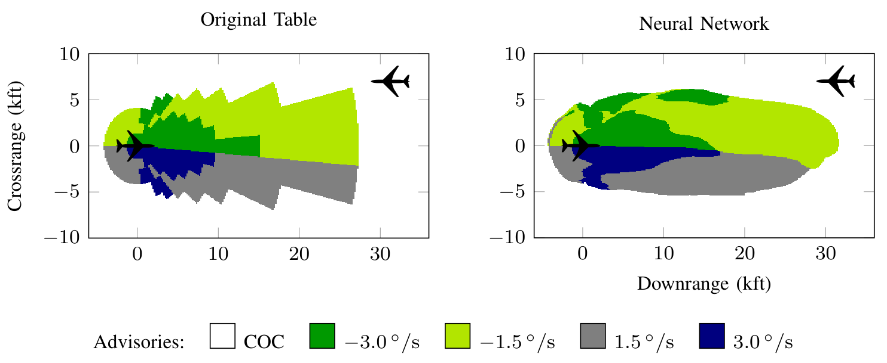
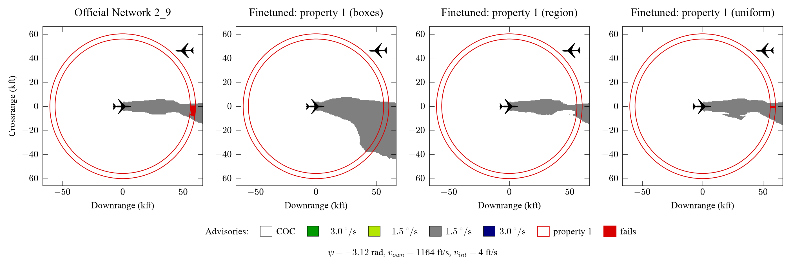
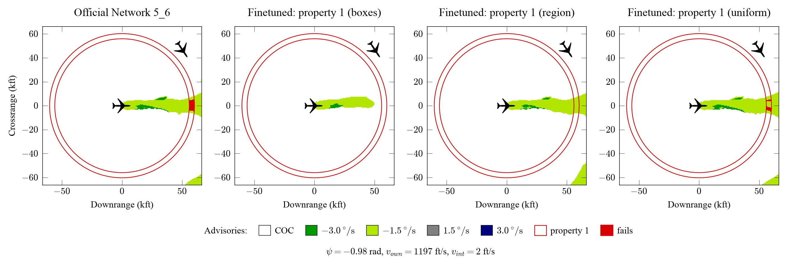
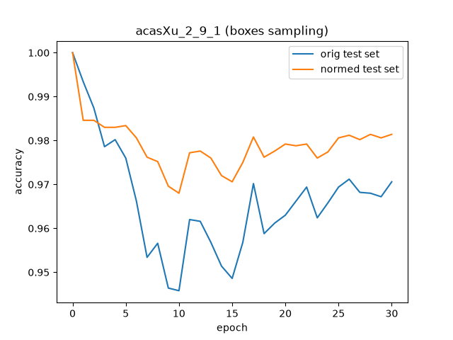

## AcasXu Experiments

**Question:** Can we finetune an official AcasXu network on a QLL property so that the property is upheld (proved by Vehicle) without a loss in accuracy?

### Directory setup

| Path                 | What it is                                                                                                                                     |
| -------------------- | ---------------------------------------------------------------------------------------------------------------------------------------------- |
| `acasXu.vcl`       | Vehicle specification of the 10 ACAS Xu properties (numbered 0–9)                                                                             |
| `official_nets/`   | the 45 official networks, `acasXu_<x>_<y>.onnx`                                                                                              |
| `acasXu_data/`     | datasets sampled from the official networks, uniform (`orig`) and class balanced (`normed`), from [ART](https://github.com/XuankangLin/ART) |
| `finetune.py`      | fine-tunes a network on properties                                                                                                             |
| `verify.py`        | runs Vehicle and Marabou on networks and properties                                                                                            |
| `visualize.py`     | advisory plots as in the paper, optionally with a property's region                                                                            |
| `finetuned_nets/`  | fine-tuned networks, `acasXu_<x>_<y>_<properties>_<sampling>.onnx`                                                                           |
| `figs/`            | accuracy plots from `finetune.py`, advisory plots from `visualize.py`                                                                      |
| `results.csv`      | every `verify.py` run: network type, model, property, result, seconds                                                                        |
| `logs/`            | Vehicle's full output for each run                                                                                                             |
| `requirements.txt` | Python dependencies                                                                                                                            |

## Setup

Python 3.11 on Linux x86_64 or macOS on Apple Silicon.

```bash
python3.11 -m venv .venv
source .venv/bin/activate
pip install -r requirements.txt
```

- **Linux x86_64:** `pip` already installed Marabou 2.0.0 (`maraboupy`).
- **Apple Silicon:** PyPI only has Marabou 1.0.0 there, which is much weaker, so build 2.0.0 from source.
  You need CMake 3.16+ and a C++ compiler; Boost and OpenBLAS are downloaded during the build.

```bash
git clone --branch v2.0.0 https://github.com/NeuralNetworkVerification/Marabou.git
cd Marabou && mkdir build && cd build
cmake .. -DBUILD_PYTHON=OFF
cmake --build . -j 8
export PATH="$PWD:$PATH"
```

`vehicle --version` (0.28.0) and `Marabou --version` (2.0.0)

## How to run

`finetune.py` writes `finetuned_nets/<name>.onnx` and an accuracy plot `figs/<name>.png`:

```bash
python finetune.py <model> <properties...> --sampling {uniform,region,boxes} [options]
python finetune.py 2.9 1 --sampling boxes --p 10000 --margin 0.002 --data-weight 10000 --lr 1e-4 --epochs 30
```

`verify.py` appends to `results.csv`, writes `logs/`, and prints each result:

```bash
python verify.py {official,finetuned}... <models|all> <properties> [--verbose] [--timeout seconds]
python verify.py official finetuned 2.9 1 --verbose --timeout 120
```

`visualize.py` plots the official network and every fine-tuned version of it into `figs/`:

```bash
python visualize.py <model> [--property k]
python visualize.py 2.9 --property 1
```

Main `finetune.py` options: `--samples` (points, for `uniform`/`region`), `--box-size` (for `boxes`), `--p`
and `--margin` (QLL), `--data orig|normed` and `--data-weight` (data loss), `--epochs`, `--batch`, `--lr`.

## Methodology

1. **Load** the official network from ONNX into PyTorch (6 hidden layers of 50 ReLUs).
2. **Train** on a mix of two losses:

   `loss = property loss + data_weight × data loss`

   - **Data loss:** mean squared error to the official network's scores on ART's training inputs.
   - **Property loss:** `max(0, QLL + margin)`, the property's QLL value pushed below `−margin`.

     - A margin is added to keep gradients trying to satisfy the property even past when QLL is 0.
     - max{} clamps QLL gradients from dominating the loss. Without max{}, the QLL loss would fall towards -inf.
   - Use data_weight = 0 to only train on the QLL property.
3. **Choose where the property loss is evaluated** (`--sampling`):

   - **`uniform`:** random points from the whole input space.
   - **`region`:** random points from the property's input region.
   - **`boxes`:** the property' input region is cut into a grid of small boxes (one range per input), and the loss uses each box's worst-case QLL value, bounded with CROWN. Each epoch, every box is re-checked and training uses the boxes not yet below `−margin`. Stop when none are left.
4. **Evaluate** accuracy on ART's test sets, and test the property with Vehicle and Marabou.

## Results

### Why property 1

Property 1 says: when the intruder is distant (ρ ≥ 55,948 ft) and much slower (v_own ≥ 1,145 ft/s, v_int ≤ 60 ft/s), COC is never the worst score.

This property was quick to check and few networks satisfied it (9/45).

We chose to finetune both model 2_9 and 5_6 against property 1.

### Plots

[Julian et al. 2016](julian2016.pdf) (Section 7) produce helpful figures that compare the lookup table vs the neural network thats trained to approximate it. The view is from above: the ownship sits at the origin flying right, and the colour at each point is the choice of action if the intruder were there. The aircraft in the top right shows the intruder's heading. The white area on the figures can be read as "advise clear of conflict if the intruder's plane was at that point". (Figure from [Julian et al. 2016](julian2016.pdf)).



- This plot only shows a slice of the 5D inputs, the distance to the intruder and angle to the intruder are free while the intruders angle, ownship speed, and intruder's speed are fixed.

### Property 1 on 2_9 and 5_6

All runs used `--p 10000 --margin 0.002 --lr 1e-4 --epochs 30 --data-weight 10000` with ART's uniform data. `region` and `uniform` used 43,200 points, the same number as there are boxes.

| sampling        | 2_9 accuracy | 2_9 Vehicle             | 5_6 accuracy | 5_6 Vehicle             |
| --------------- | ------------ | ----------------------- | ------------ | ----------------------- |
| official        | 100%         | counterexample (17 s)   | 100%         | counterexample (0.5 s)  |
| uniform         | 99.6%        | counterexample (39 s)   | 99.7%        | counterexample (0.6 s)  |
| region          | 99.8%        | counterexample (322 s)  | 99.6%        | no answer after 1 h    |
| **boxes** | 97.1%        | **proved (48 s)** | 98.3%        | **proved (58 s)** |

- **Boxes:** property 1's region was cut into 43,200 boxes (3 × 40 × 40 × 3 × 3, side 0.025 in normalised units). Every box was certified after 19 epochs on 2_9 and after 3 on 5_6.

Vehicle's output for the official 2_9 and the box-trained one:

```
official   2_9        property1  falsified   16.8 s
    x: [ 56778.388885, -0.117614921296, -3.123942536144, 1145.0, 7.4604 ]
finetuned  2_9_1_boxes property1  verified    47.6 s
```




Zoomed out to show property 1's region: the red ring between 55.9 and 60.3 kft. Filled red is where property 1 fails in that slice.

Region- and uniform-trained nets look almost unchanged, but their counterexamples are in other slices.

Accuracy during the box run on 2_9 dips first and then recovers:



---

## Takeaways

* Should train on both (data from the whole input space to keep accuracy) + (data relevant to the property to satisfy the QLL property). Training on points in the region wasn't enough, Vehicle found a counterexample. Finding the worst case per box in the input region worked on two models so far.

- Our fine-tuning: Every box was certified after 3–19 epochs but finding the worst case within each "box" was an expensive step in MPC.
